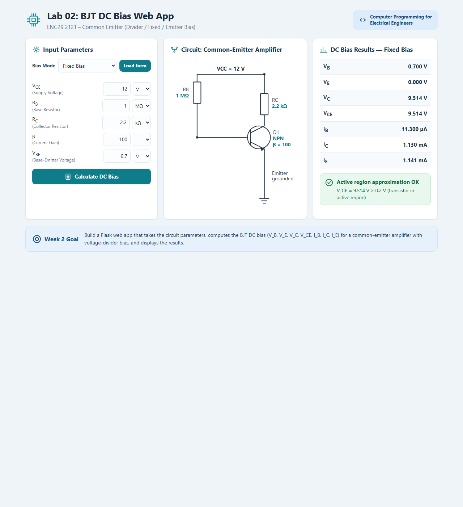
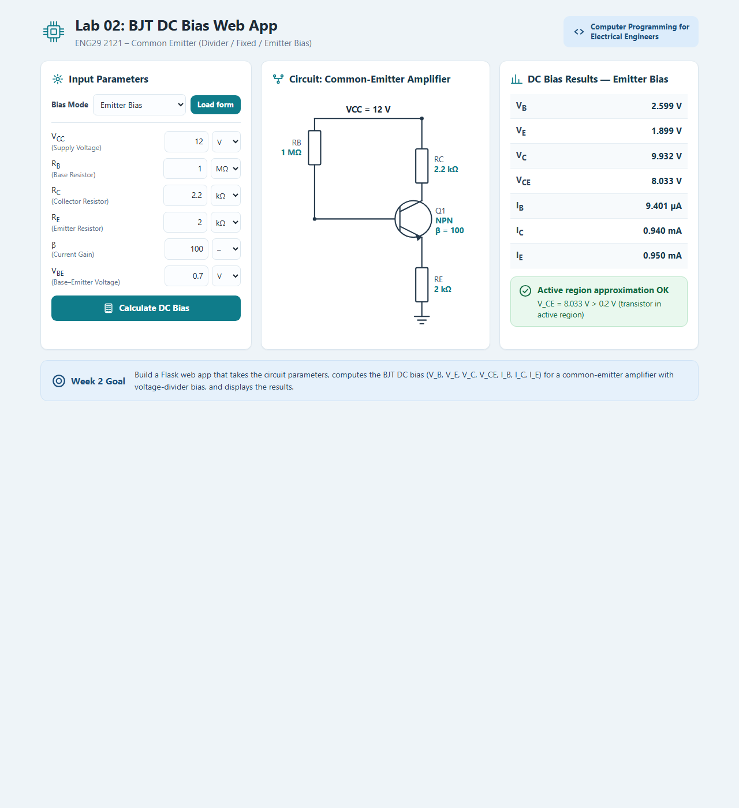

# Lab 03 — Browser Acceptance (A1–A5)

ค่าคงที่ร่วมทุกกรณี: **VCC = 12 V, RC = 2.2 kΩ, β = 100, VBE = 0.70 V**
เกณฑ์ผ่าน: IC ต่างไม่เกิน **0.01 mA**, VCE ต่างไม่เกิน **0.02 V**
(เทียบค่าที่หน้าเว็บแสดงกับค่าอ้างอิงที่ยังไม่ปัดเศษ)

## เครื่องมือที่ใช้ตรวจ และเหตุผลที่เปลี่ยนจาก Playwright MCP

**ใช้:** Microsoft Edge (Chromium) แบบ headless — `--headless=new --dump-dom` และ
`--screenshot` โดยโหลดฟอร์ม HTML ที่ส่ง POST จริงไปที่ `http://127.0.0.1:5000/`
ทุกกรณี เป็นการเปิดหน้าเว็บด้วยเบราว์เซอร์จริง ไม่ใช่การยิง HTTP ตรง

**เหตุผลที่ไม่ได้ใช้ Playwright MCP:** เครื่องที่ตรวจไม่มี `node` และ `npx`
(ตรวจแล้วได้ `CommandNotFoundException`) ทำให้ MCP server `playwright`
ใน `opencode.json` เริ่มไม่ได้ และไม่มี Google Chrome ที่ path มาตรฐาน
จึงใช้ Microsoft Edge ที่ติดตั้งมากับ Windows แทน — ยังเป็น Chromium engine
ตัวเดียวกับที่ Playwright ใช้

**บทบาทของ MCP ในงานนี้:** MCP คือ protocol ที่ให้ AI เรียกเครื่องมือภายนอก
(เช่น Playwright) เพื่อสั่งเบราว์เซอร์แบบ interactive — เปิดหน้าเว็บ กรอกช่อง
กดปุ่ม อ่าน snapshot และถ่ายภาพหน้าจอในรอบเดียว เมื่อ MCP ไม่พร้อม ผมจึงเรียก
Edge ผ่าน command line แทน ซึ่งยังได้ผลจากเบราว์เซอร์จริง แต่ต้องสั่งทีละคำสั่ง
และอ่านผลจาก DOM ที่ dump ออกมาแทน snapshot ของ MCP

**สคริปต์ที่ใช้ (ทำซ้ำได้):** [`scripts/browser_acceptance.py`](../scripts/browser_acceptance.py)

```powershell
.\.venv\Scripts\python.exe -m bjt_bias.app     # เปิดเซิร์ฟเวอร์ค้างไว้
.\.venv\Scripts\python.exe scripts\browser_acceptance.py
```

## ผลตรวจ A1–A5 (จากหน้าเว็บจริง)

| กรณี | เลือกโหมดและกรอกค่า | คาดหมายก่อนรัน | เห็นจริงบนหน้าเว็บ | วิธีตรวจ | สถานะ |
|---|---|---|---|---|---|
| A1 · โหมดเดิม | Divider · R1 = 100 kΩ, R2 = 22 kΩ, RE = 1 kΩ | IC = 1.2298 mA · VCE = 8.0522 V | IC = **1.230 mA** · VCE = **8.052 V** · IB 12.299 µA · IE 1.242 mA | Edge headless (browser) | **PASS** |
| A2 · Fixed | Fixed · RB = 1 MΩ | IC = 1.1300 mA · VCE = 9.5140 V | IC = **1.130 mA** · VCE = **9.514 V** · IB 11.300 µA · IE 1.141 mA | Edge headless (browser) | **PASS** |
| A3 · Emitter | Emitter · RB = 1 MΩ, RE = 1 kΩ | IC = 1.0263 mA · VCE = 8.7054 V | IC = **1.026 mA** · VCE = **8.705 V** · IB 10.263 µA · IE 1.037 mA | Edge headless (browser) | **PASS** |
| A4 · เปลี่ยนค่าเดียว | Emitter · RB = 1 MΩ, RE = 2 kΩ | IC **ลดลง** จาก A3 · IC = 0.9401 mA · VCE = 8.0328 V | IC = **0.940 mA** (ลดลงจาก A3) · VCE = **8.033 V** · IB 9.401 µA | Edge headless (browser) | **PASS** |
| A5 · อินพุตผิด | Fixed · RB = 0 | แจ้งให้แก้ RB, หน้าเว็บไม่ล่ม, ไม่มีผลรอบก่อนค้าง | หัวข้อ **“Invalid input (Fixed Bias)”** + ข้อความ **“RB must be a finite number greater than zero.”** ไม่มีตารางผล ไม่มี banner | Edge headless (browser) | **PASS** |

ทุกกรณีขึ้น banner **Active region approximation OK** (ยกเว้น A5 ที่ไม่มีผลลัพธ์)
และไดอะแกรมเปลี่ยนตามโหมดจริง: Divider = R1+R2+RE, Fixed = RB + “Emitter grounded”,
Emitter = RB+RE

## หลักฐานจากหน้าเว็บ

ภาพหน้าจอจากการรันจริง (Edge headless, 1280×1400):

| กรณี | ภาพ |
|---|---|
| A1 Divider |  |
| A2 Fixed |  |
| A3 Emitter |  |
| A4 Emitter RE = 2 kΩ |  |
| A5 RB = 0 |  |

ข้อความผลที่คัดจาก DOM ของหน้าเว็บ:

```
A2 (Fixed Bias):  VB 0.700 V | VE 0.000 V | VC 9.514 V | VCE 9.514 V
                  IB 11.300 µA | IC 1.130 mA | IE 1.141 mA
                  banner: Active region approximation OK
A5 (Fixed, RB = 0): Invalid input (Fixed Bias)
                  RB must be a finite number greater than zero.
```

## ทวนเองโดยนักศึกษา (อย่างน้อย 1 กรณี)

> ช่องนี้ต้องกรอกโดยนักศึกษาเอง (AI ทำแทนไม่ได้) — เปิด
> <http://127.0.0.1:5000/> ด้วยเบราว์เซอร์ของตัวเอง เลือก **Fixed Bias**,
> กรอก RB = **1 MΩ**, กด **Calculate DC Bias** แล้วจดค่าที่เห็น

| วันที่ | กรณี | ค่าที่เห็นเอง | ตรงกับตาราง | หมายเหตุ |
|---|---|---|---|---|
|  | A2 |  |  |  |

## ค่าอ้างอิง (คำนวณมือ — ไม่ได้มาจากโปรแกรม)

**A1 — Divider** (R1 = 100 kΩ, R2 = 22 kΩ, RE = 1 kΩ)

```
VTH = 12 × 22 / (100 + 22)      = 2.163934 V
RTH = 100 × 22 / (100 + 22) kΩ  = 18.032787 kΩ
IB  = (2.163934 − 0.70) / (18032.787 + 101 × 1000)
    = 1.463934 / 119032.787     = 12.2985 µA
IC  = 100 × 12.2985 µA          = 1.22985 mA
IE  = 101 × 12.2985 µA          = 1.24215 mA
VE  = 1.24215 V
VC  = 12 − 1.22985 mA × 2.2 kΩ  = 9.29433 V
VCE = 9.29433 − 1.24215         = 8.05218 V
```

**A2 — Fixed** (RB = 1 MΩ)

```
IB  = (12 − 0.70) / 1 MΩ  = 11.3 µA
IC  = 100 × 11.3 µA       = 1.1300 mA
IE  = 101 × 11.3 µA       = 1.1413 mA
VE  = 0 V
VB  = 0.70 V
VC  = 12 − 1.1300 mA × 2.2 kΩ = 9.5140 V
VCE = 9.5140 V
```

**A3 — Emitter** (RB = 1 MΩ, RE = 1 kΩ)

```
IB  = (12 − 0.70) / (1 MΩ + 101 × 1 kΩ) = 11.3 / 1.101 MΩ = 10.2634 µA
IC  = 100 × 10.2634 µA = 1.02634 mA
IE  = 101 × 10.2634 µA = 1.03660 mA
VE  = 1.03660 mA × 1 kΩ = 1.03660 V
VC  = 12 − 1.02634 mA × 2.2 kΩ = 9.74205 V
VCE = 9.74205 − 1.03660 = 8.70545 V
```

**A4 — Emitter, RE = 2 kΩ**

```
IB  = 11.3 / (1 MΩ + 101 × 2 kΩ) = 11.3 / 1.202 MΩ = 9.40100 µA
IC  = 100 × 9.40100 µA = 0.94010 mA
IE  = 101 × 9.40100 µA = 0.94950 mA
VE  = 0.94950 mA × 2 kΩ = 1.89900 V
VC  = 12 − 0.94010 mA × 2.2 kΩ = 9.93178 V
VCE = 9.93178 − 1.89900 = 8.03278 V
```

ทำนาย A4: RE ใหญ่ขึ้น → emitter degeneration มากขึ้น → IB เล็กลง →
**IC ลดลง** จาก 1.0263 mA เหลือ 0.9401 mA (หน้าเว็บแสดง 1.026 → 0.940 mA)

**A5 — Fixed, RB = 0**

`IB = (12 − 0.70) / 0` ไม่นิยาม → ต้องถูกปฏิเสธที่ชั้นตรวจอินพุตด้วยข้อความที่ระบุ RB

---

# Lab 04 — CE Voltage-Divider Simulator (SPICE)

ส่วนนี้เป็นผลตรวจจริงจาก ngspice ที่รันผ่านหน้าเว็บ (ไม่ใช่ค่าที่คำนวณแทน)
ค่า Analytical กับ SPICE ถูกแสดงคนละป้ายเสมอ เพราะใช้สมมติฐานคนละชุด

## สภาพแวดล้อมที่ตรวจ

| รายการ | เวอร์ชัน / ค่าที่ตรวจได้ |
|---|---|
| OS | Windows 11, `10.0.26300.0` (display version `26H2`) |
| Python | `3.14.10` (64-bit) |
| Flask | `3.1.3` (dependency เดียวใน `requirements.txt`) |
| SPICE engine | ngspice-47 — `C:\Tools\ngspice-47\bin\ngspice_con.exe`, คำสั่ง `--version` ขึ้น `** ngspice-47` |
| BJT model | `2N3904` (`.model Q2N3904 NPN`) ใน `bjt_bias/spice_models/2n3904.lib` |
| Model SHA256 | `E3B36B89C491C09E24986692E556095403E3D4CCE1EEB1A71DA06DAEA3C5E589` |
| Browser | Microsoft Edge `--headless=new` (`--dump-dom`, `--screenshot`) |
| Repo | <https://github.com/pleng4995-cloud/Git-Lab.git> |
| Commit ของ Lab 04 | [`2c41279`](https://github.com/pleng4995-cloud/Git-Lab/commit/2c4127930ce498af9ddf1d6b5df4a55d722495a1) (`2c4127930ce498af9ddf1d6b5df4a55d722495a1`) |

ที่มาของ model: ไม่มี Instructor Starter Kit ในเครื่องนี้ จึงใช้ 2N3904 model
card ที่เผยแพร่สาธารณะ (ON Semiconductor / Motorola, `Is=6.734f`, `BF=416.4`,
`VAF=74.03`) — ตรวจ sources และวิธีเปลี่ยน model ได้ใน
[`bjt_bias/spice_models/README.md`](../bjt_bias/spice_models/README.md) model
**ไม่ได้**ถูก fit ให้ตรงกับผล Analytical

## วงจรอ้างอิง (baseline v1)

VCC 12 V · R1 100 kΩ · R2 22 kΩ · RC 2.2 kΩ · RE 1 kΩ · RL 10 kΩ ·
Cin = Cout = 10 µF · แหล่งสัญญาณ 10 mV peak @ 1 kHz · **ไม่ใส่ emitter bypass
capacitor** (`CE`) ตามใบงาน v1 — จุดวัด Vin คือโหนด `vin` ฝั่งแหล่งสัญญาณก่อน
Cin, Vout คือโหนด `out` หลัง Cout คร่อม RL

## ค่าอ้างอิงอิสระของ AC / Transient (คำนวณมือ ก่อนรัน)

```
IE   ≈ 1.242 mA  (ค่าจาก A1, β=100, VBE=0.70 V)
re   = VT / IE = 25.85 mV / 1.242 mA ≈ 20.8 Ω
RC ∥ RL = 2.2 kΩ ∥ 10 kΩ = 1803 Ω
|Av| ≈ (RC ∥ RL) / (RE + re) = 1803 / (1000 + 20.8) ≈ 1.77
      → 20·log10(1.77) ≈ 4.95 dB, เฟสกลับ ≈ 180° (CE ไม่มี bypass)
Vout ≈ 1.77 × 10 mV ≈ 17.7 mV peak → ≈ 35 mV p-p
fCout = 1 / (2π·(RC+RL)·Cout) = 1 / (2π·12.2 kΩ·10 µF) ≈ 1.30 Hz
fCin  = 1 / (2π·Rin·Cin), Rin ≈ R1∥R2∥(rπ + (β+1)·RE)  (หลัก Hz ต่ำ ๆ)
```

ค่าที่รันจริงต้องอยู่ในอันดับเดียวกันนี้ (gain หลักหน่วย ไม่ใช่หลักร้อย ถ้าได้
หลักร้อยแปลว่ามี bypass capacitor ซึ่งไม่มีใน baseline) หมายเหตุ: Analytical
ใช้ β/VBE คงที่จาก `bjt_bias/bias.py` ส่วน SPICE ใช้ model card ที่มี `BF=416.4`
และ VBE แปรตามกระแส — **ไม่ต้องเท่ากัน** และไม่ได้นำค่าข้างหนึ่งไปแทนอีกข้าง

## ผลตรวจ B1–B8 (เบราว์เซอร์จริง)

| Case | Method | Input | Expected / Reference | Observed | Evidence | Status |
|---|---|---|---|---|---|---|
| B1 | Edge POST `analysis=analytical` สลับ 3 โหมด | A1–A4 ของ Lab 03 | IC/VCE = 1.230/8.052, 1.130/9.514, 1.026/8.705, 0.940/8.033 mA/V | ตรงทั้ง 4 ชุด · มี `ANALYTICAL · bias.py` · ไม่มี SPICE panel | [`b1.png`](evidence/lab4/b1.png), [`b1-a2.png`](evidence/lab4/b1-a2.png), [`b1-a3.png`](evidence/lab4/b1-a3.png), [`b1-a4.png`](evidence/lab4/b1-a4.png) | **PASS** |
| B2 | Edge POST `analysis=dc` | baseline | SPICE `.op` แยกจาก Analytical + model/run id/status ok | run `20261124T174238-ddc674` · ngspice-47 · VB 1.942→2.004 V, VE 1.242→1.333 V, VC 9.294→9.087 V, VCE 8.052→7.754 V, IB 12.299→8.887 µA, IC 1.230→1.324 mA, IE 1.242→−1.333 mA (Analytical→SPICE; เครื่องหมาย IE ติดลบเป็น sign convention ของ ngspice) | [`b2.png`](evidence/lab4/b2.png), [`b2-netlist.cir`](evidence/lab4/b2-netlist.cir), [`b2-op.txt`](evidence/lab4/b2-op.txt), [`acceptance-main.json`](evidence/lab4/acceptance-main.json) | **PASS** |
| B3 | Edge POST `analysis=dc` หลังเปลี่ยน RE | RE 1 kΩ → 2 kΩ | IC/VE/VCE เปลี่ยนและ run id ใหม่ | IC 1.324→0.705 mA, VE 1.333→1.419 V, VCE 7.754→9.032 V · run `20261124T174239-d9342c` ≠ B2 | [`b3.png`](evidence/lab4/b3.png), [`b3-netlist.cir`](evidence/lab4/b3-netlist.cir), [`b3-op.txt`](evidence/lab4/b3-op.txt) | **PASS** |
| B4 | Edge POST `analysis=ac` | 10 Hz–1 MHz, 20 pts/dec | Bode log-x + gain dB + phase deg + run id, gain ≈ 4.95 dB | 101 rows · @1 kHz = 4.8896 dB / −179.87° · run `20261124T174241-a9d073` | [`b4.png`](evidence/lab4/b4.png), [`b4-netlist.cir`](evidence/lab4/b4-netlist.cir), [`b4-ac.txt`](evidence/lab4/b4-ac.txt) | **PASS** |
| B5 | Edge POST `analysis=tran` | 10 mV peak, 1 kHz | กลับเฟส ≈180°, Vout p-p ≈ 35 mV | 1008 rows · corr(Vin,Vout) = −1.0 · Vout p-p = 0.0351139824 V · run `20261124T174243-13be6c` | [`b5.png`](evidence/lab4/b5.png), [`b5-netlist.cir`](evidence/lab4/b5-netlist.cir), [`b5-tran.txt`](evidence/lab4/b5-tran.txt) | **PASS** |
| B6 | Edge POST `analysis=tran` หลังเปลี่ยน amplitude | 10 → 20 mV | Vout ≈ 2× เดิม, run id ใหม่ | Vout p-p = 0.0702278849 V (2.000×) · 1008 rows · run `20261124T174245-50c2b3` ≠ B5 | [`b6.png`](evidence/lab4/b6.png), [`b6-netlist.cir`](evidence/lab4/b6-netlist.cir), [`b6-tran.txt`](evidence/lab4/b6-tran.txt) | **PASS** |
| B7(a) | Edge POST `RE = 0` | `analysis=dc`, RE 0 | error ระบุ RE, ไม่เรียก engine, ไม่มีกราฟ | `RE must be a finite number greater than zero.` · ไม่มี SPICE panel / run id / plot | [`b7a.png`](evidence/lab4/b7a.png), [`b7a-error.txt`](evidence/lab4/b7a-error.txt) | **PASS** |
| B7(b) | รีสตาร์ท Flask ด้วย `NGSPICE_BIN` ผิด แล้ว Edge POST | `NGSPICE_BIN=C:\does-not-exist\ngspice.exe`, port 5001 | engine_missing badge แดง + วิธีติดตั้ง, ไม่มีกราฟ | engine bar แดง · `ngspice not found (C:\does-not-exist\ngspice.exe (missing))` · ไม่มี run id / plot | [`b7b.png`](evidence/lab4/b7b.png), [`b7b-error.txt`](evidence/lab4/b7b-error.txt), [`acceptance-b7b.json`](evidence/lab4/acceptance-b7b.json) | **PASS** |
| B8 | Edge POST `analysis=ac` สองขนาดหน้าต่าง | desktop 1280×1400, mobile 390×900 | กราฟ/หน่วย/ปุ่มไม่ถูกตัด, ตารางเลื่อนได้ | SVG + `Gain (dB)` / `Phase (deg)` / `Frequency (Hz)` อยู่ใน DOM ทั้งสองขนาด · desktop run `20261124T174248-1be2f6`, mobile run `20261124T174250-4f2564` | [`b8-desktop.png`](evidence/lab4/b8-desktop.png), [`b8-mobile.png`](evidence/lab4/b8-mobile.png), netlist/AC excerpt: [`desktop`](evidence/lab4/b8-desktop-netlist.cir) · [`mobile`](evidence/lab4/b8-mobile-netlist.cir) | **PASS** (DOM proxy; ตรวจภาพด้วยตาโดยนักศึกษา — ตารางด้านล่าง) |

สคริปต์ที่ทำซ้ำได้: [`scripts/browser_acceptance_lab4.py`](../scripts/browser_acceptance_lab4.py)
ผลลัพธ์: **76/76 checks PASS** (หลัก) และ **7/7 checks PASS** (B7(b)) — ดู
[`checks-main.txt`](evidence/lab4/checks-main.txt) และ
[`checks-b7b.txt`](evidence/lab4/checks-b7b.txt) วิธีจำลอง engine ไม่พร้อมคือ
ตั้ง `NGSPICE_BIN` ให้ชี้ path ที่ไม่มี **ไม่ได้ปิด ngspice จริงทั้งเครื่อง**

regression เพิ่มเติม: [`scripts/browser_layout_check.py`](../scripts/browser_layout_check.py)
วัด `getBoundingClientRect()` ของ `.source-field` ใน Edge headless ก่อนแก้ที่
1280×1400 พบ `0 input <> 1 label` และ `2 input <> 3 label` เพราะ input กว้าง
132px ล้นคอลัมน์ที่กว้าง ~143px ภายใน `.source-group` แบบ 2 คอลัมน์ หลังเปลี่ยน
`.source-field` เป็น `display:block` ผล **PASS ทั้ง 1280×1400 และ 390×900**
(ไม่มี conflict/overflow) — เป็น DOM geometry proxy ภาพยังต้องให้นักศึกษาตรวจด้วยตา

หลักฐานเพิ่มเติมใน `docs/evidence/lab4/`: netlist ที่รันจริง (`*-netlist.cir`),
excerpt ของ `op.txt` / `ac.txt` / `tran.txt` (`b2-op.txt`, `b4-ac.txt`,
`b5-tran.txt` ฯลฯ) และข้อความ error ของ B7 (`b7a-error.txt`, `b7b-error.txt`)
สคริปต์ถ่าย screenshot จาก DOM snapshot ของ **POST เดียวกัน** (ไม่ได้โพสต์ซ้ำ)
จึงทำให้ run id ในตารางตรงกับสิ่งที่ปรากฏในภาพทุกครั้ง

### ไฟล์ Simulation & Plots (รันใหม่ แยกจาก B4/B5)

เพื่อให้เปิด/ส่งกราฟได้โดยตรง จึงรัน POST จริงอีกชุดผ่าน Flask `test_client()`
ด้วย baseline เดียวกัน (ไม่ใช่ browser case และไม่ได้ hard-code curve) แล้วให้
`bjt_bias/plots.py` สร้าง SVG จาก `ac.txt` / `tran.txt` ที่ ngspice เขียนจริง
PNG ถูก render จาก SVG ชุดเดียวกันด้วย Edge headless (1200×900) ผลลัพธ์เป็น
**run ใหม่** จึงไม่ใช้แทน run id ของ B4/B5 ในตารางด้านบน

| ผล | run id | ไฟล์ที่ใช้ได้เลย | ค่าที่อ่านจากผลรันจริง |
|---|---|---|---|
| AC sweep (10 Hz–1 MHz, 20 pts/dec) | `20261124T180939-9172e2` | [SVG](evidence/lab4/simulation-ac.svg) · [PNG](evidence/lab4/simulation-ac.png) | 101 points · @1 kHz = **4.88959084 dB / −179.871168°** · chart max 4.89 dB, phase ±180° |
| Transient (10 mV peak, 1 kHz) | `20261124T180940-eb14f0` | [SVG](evidence/lab4/simulation-tran.svg) · [PNG](evidence/lab4/simulation-tran.png) | 1008 points · Vin p-p = **19.999 mV** · Vout p-p = **35.116 mV** (charts max 17.6 mV / min −17.5 mV) |

ตรวจแล้วว่า SVG ทั้งสอง parse เป็น XML ได้ มี label `Gain (dB)`, `Phase (deg)`,
`Frequency (Hz)` และ `Time (ms)`, `Vin`, `Vout` พร้อม run id ตรงกับ `meta.json`
(`status: ok`, `ngspice-47`, model SHA256 ตัวเดียวกับตารางสภาพแวดล้อม) และ PNG
มีขนาด 1200×900 — ใช้ XML/DOM assertion เป็น proxy เท่านั้น ภาพยังต้องให้
นักศึกษาดูด้วยตาในตาราง manual audit ด้านล่าง (AI ไม่ได้กรอกแทน)

## เครื่องมือตรวจ และเหตุผลที่ไม่ใช้ Playwright MCP / Impeccable

ใช้ Microsoft Edge headless เพราะเครื่องนี้ไม่มี `node`/`npx` (ตรวจแล้วได้
`CommandNotFoundException`) ทำให้ MCP server `playwright` ใน `opencode.json`
เริ่มไม่ได้ และไม่มี Google Chrome ที่ path มาตรฐาน Edge เป็น Chromium engine
ตัวเดียวกับที่ Playwright ใช้ จึงยังเป็นการ POST จริงผ่านเบราว์เซอร์ + อ่าน DOM
+ บันทึก screenshot เหมือนเดิม (อธิบายเพิ่มในส่วน Lab 03 ด้านบน)

ไม่ใช้ Impeccable/skill ตรวจภาพ เพราะไม่มี browser tool แบบ interactive ที่
เสียบเข้ากับ MCP ได้ และโมเดลนี้ไม่สามารถอ่านไฟล์ PNG ที่ screenshot ไว้ได้
จึงใช้ **DOM assertion เป็น proxy** สำหรับ B8 แล้วทิ้งภาพไว้ให้ตรวจด้วยตาอีกรอบ

### Manual audit โดยนักศึกษา (ยังไม่กรอก — อย่าให้ AI แทน)

เปิด <http://127.0.0.1:5000/> ด้วยเบราว์เซอร์ของตัวเอง กด **Run SPICE DC**,
**Run AC sweep**, **Run Transient** แล้วเทียบกับตาราง B2/B4/B5 และลดขนาด
หน้าต่างเหลือ ~390 px สำหรับ B8

| วันที่ | กรณี | สิ่งที่เห็นเอง | ตรงตามตาราง | หมายเหตุ |
|---|---|---|---|---|
|  | Lab 03 A2 |  |  | (ยังค้างจากส่วน Lab 03) |
|  | Lab 04 B2 |  |  |  |
|  | Lab 04 B4 |  |  |  |
|  | Lab 04 B5 |  |  |  |
|  | Lab 04 B8 mobile |  |  |  |
