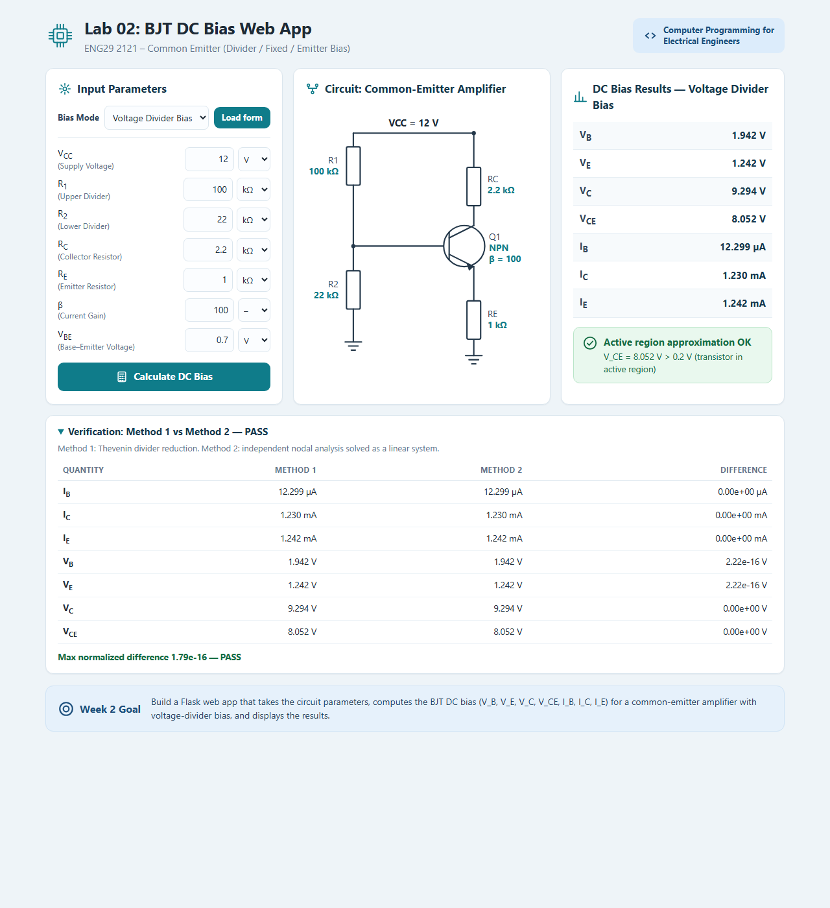
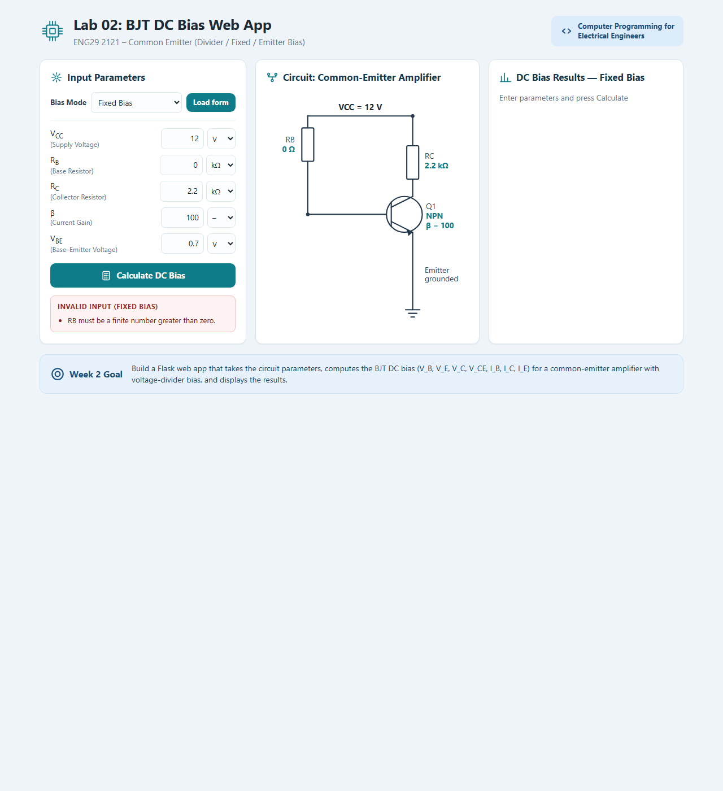

# Lab 03 — Browser Acceptance (A1–A5)

ค่าคงที่ร่วมทุกกรณี: **VCC = 12 V, RC = 2.2 kΩ, β = 100, VBE = 0.70 V**
เกณฑ์ผ่าน: IC ต่างไม่เกิน **0.01 mA**, VCE ต่างไม่เกิน **0.02 V**
(เทียบค่าที่หน้าเว็บแสดงกับค่าอ้างอิงที่ยังไม่ปัดเศษ)

## เครื่องมือที่ใช้ตรวจ และเหตุผลที่เปลี่ยนจาก Playwright MCP

**ใช้:** Microsoft Edge (Chromium) แบบ headless — `--headless=new --dump-dom` และ
`--screenshot` โดยโหลดฟอร์ม HTML ที่ส่ง POST จริงไปที่ `http://127.0.0.1:5000/`
ทุกกรณี เป็นการเปิดหน้าเว็บด้วยเบราว์เซอร์จริง ไม่ใช่การยิง HTTP ตรง

**เหตุผลที่ไม่ได้ใช้ Playwright MCP:** เครื่องที่ตรวจไม่มี `node` และ `npx`
(ตรวจแล้วได้ `CommandNotFoundException`) ทำให้ MCP server `playwright`
ใน `opencode.json` เริ่มไม่ได้ และไม่มี Google Chrome ที่ path มาตรฐาน
จึงใช้ Microsoft Edge ที่ติดตั้งมากับ Windows แทน — ยังเป็น Chromium engine
ตัวเดียวกับที่ Playwright ใช้

**บทบาทของ MCP ในงานนี้:** MCP คือ protocol ที่ให้ AI เรียกเครื่องมือภายนอก
(เช่น Playwright) เพื่อสั่งเบราว์เซอร์แบบ interactive — เปิดหน้าเว็บ กรอกช่อง
กดปุ่ม อ่าน snapshot และถ่ายภาพหน้าจอในรอบเดียว เมื่อ MCP ไม่พร้อม ผมจึงเรียก
Edge ผ่าน command line แทน ซึ่งยังได้ผลจากเบราว์เซอร์จริง แต่ต้องสั่งทีละคำสั่ง
และอ่านผลจาก DOM ที่ dump ออกมาแทน snapshot ของ MCP

**สคริปต์ที่ใช้ (ทำซ้ำได้):** [`scripts/browser_acceptance.py`](../scripts/browser_acceptance.py)

```powershell
.\.venv\Scripts\python.exe -m bjt_bias.app     # เปิดเซิร์ฟเวอร์ค้างไว้
.\.venv\Scripts\python.exe scripts\browser_acceptance.py
```

## ผลตรวจ A1–A5 (จากหน้าเว็บจริง)

| กรณี | เลือกโหมดและกรอกค่า | คาดหมายก่อนรัน | เห็นจริงบนหน้าเว็บ | วิธีตรวจ | สถานะ |
|---|---|---|---|---|---|
| A1 · โหมดเดิม | Divider · R1 = 100 kΩ, R2 = 22 kΩ, RE = 1 kΩ | IC = 1.2298 mA · VCE = 8.0522 V | IC = **1.230 mA** · VCE = **8.052 V** · IB 12.299 µA · IE 1.242 mA | Edge headless (browser) | **PASS** |
| A2 · Fixed | Fixed · RB = 1 MΩ | IC = 1.1300 mA · VCE = 9.5140 V | IC = **1.130 mA** · VCE = **9.514 V** · IB 11.300 µA · IE 1.141 mA | Edge headless (browser) | **PASS** |
| A3 · Emitter | Emitter · RB = 1 MΩ, RE = 1 kΩ | IC = 1.0263 mA · VCE = 8.7054 V | IC = **1.026 mA** · VCE = **8.705 V** · IB 10.263 µA · IE 1.037 mA | Edge headless (browser) | **PASS** |
| A4 · เปลี่ยนค่าเดียว | Emitter · RB = 1 MΩ, RE = 2 kΩ | IC **ลดลง** จาก A3 · IC = 0.9401 mA · VCE = 8.0328 V | IC = **0.940 mA** (ลดลงจาก A3) · VCE = **8.033 V** · IB 9.401 µA | Edge headless (browser) | **PASS** |
| A5 · อินพุตผิด | Fixed · RB = 0 | แจ้งให้แก้ RB, หน้าเว็บไม่ล่ม, ไม่มีผลรอบก่อนค้าง | หัวข้อ **“Invalid input (Fixed Bias)”** + ข้อความ **“RB must be a finite number greater than zero.”** ไม่มีตารางผล ไม่มี banner | Edge headless (browser) | **PASS** |

ทุกกรณีขึ้น banner **Active region approximation OK** (ยกเว้น A5 ที่ไม่มีผลลัพธ์)
และไดอะแกรมเปลี่ยนตามโหมดจริง: Divider = R1+R2+RE, Fixed = RB + “Emitter grounded”,
Emitter = RB+RE

## หลักฐานจากหน้าเว็บ

ภาพหน้าจอจากการรันจริง (Edge headless, 1280×1400):

| กรณี | ภาพ |
|---|---|
| A1 Divider |  |
| A2 Fixed |  |
| A3 Emitter |  |
| A4 Emitter RE = 2 kΩ |  |
| A5 RB = 0 |  |

ข้อความผลที่คัดจาก DOM ของหน้าเว็บ:

```
A2 (Fixed Bias):  VB 0.700 V | VE 0.000 V | VC 9.514 V | VCE 9.514 V
                  IB 11.300 µA | IC 1.130 mA | IE 1.141 mA
                  banner: Active region approximation OK
A5 (Fixed, RB = 0): Invalid input (Fixed Bias)
                  RB must be a finite number greater than zero.
```

## ทวนเองโดยนักศึกษา (อย่างน้อย 1 กรณี)

> ช่องนี้ต้องกรอกโดยนักศึกษาเอง (AI ทำแทนไม่ได้) — เปิด
> <http://127.0.0.1:5000/> ด้วยเบราว์เซอร์ของตัวเอง เลือก **Fixed Bias**,
> กรอก RB = **1 MΩ**, กด **Calculate DC Bias** แล้วจดค่าที่เห็น

| วันที่ | กรณี | ค่าที่เห็นเอง | ตรงกับตาราง | หมายเหตุ |
|---|---|---|---|---|
|  | A2 |  |  |  |

## ค่าอ้างอิง (คำนวณมือ — ไม่ได้มาจากโปรแกรม)

**A1 — Divider** (R1 = 100 kΩ, R2 = 22 kΩ, RE = 1 kΩ)

```
VTH = 12 × 22 / (100 + 22)      = 2.163934 V
RTH = 100 × 22 / (100 + 22) kΩ  = 18.032787 kΩ
IB  = (2.163934 − 0.70) / (18032.787 + 101 × 1000)
    = 1.463934 / 119032.787     = 12.2985 µA
IC  = 100 × 12.2985 µA          = 1.22985 mA
IE  = 101 × 12.2985 µA          = 1.24215 mA
VE  = 1.24215 V
VC  = 12 − 1.22985 mA × 2.2 kΩ  = 9.29433 V
VCE = 9.29433 − 1.24215         = 8.05218 V
```

**A2 — Fixed** (RB = 1 MΩ)

```
IB  = (12 − 0.70) / 1 MΩ  = 11.3 µA
IC  = 100 × 11.3 µA       = 1.1300 mA
IE  = 101 × 11.3 µA       = 1.1413 mA
VE  = 0 V
VB  = 0.70 V
VC  = 12 − 1.1300 mA × 2.2 kΩ = 9.5140 V
VCE = 9.5140 V
```

**A3 — Emitter** (RB = 1 MΩ, RE = 1 kΩ)

```
IB  = (12 − 0.70) / (1 MΩ + 101 × 1 kΩ) = 11.3 / 1.101 MΩ = 10.2634 µA
IC  = 100 × 10.2634 µA = 1.02634 mA
IE  = 101 × 10.2634 µA = 1.03660 mA
VE  = 1.03660 mA × 1 kΩ = 1.03660 V
VC  = 12 − 1.02634 mA × 2.2 kΩ = 9.74205 V
VCE = 9.74205 − 1.03660 = 8.70545 V
```

**A4 — Emitter, RE = 2 kΩ**

```
IB  = 11.3 / (1 MΩ + 101 × 2 kΩ) = 11.3 / 1.202 MΩ = 9.40100 µA
IC  = 100 × 9.40100 µA = 0.94010 mA
IE  = 101 × 9.40100 µA = 0.94950 mA
VE  = 0.94950 mA × 2 kΩ = 1.89900 V
VC  = 12 − 0.94010 mA × 2.2 kΩ = 9.93178 V
VCE = 9.93178 − 1.89900 = 8.03278 V
```

ทำนาย A4: RE ใหญ่ขึ้น → emitter degeneration มากขึ้น → IB เล็กลง →
**IC ลดลง** จาก 1.0263 mA เหลือ 0.9401 mA (หน้าเว็บแสดง 1.026 → 0.940 mA)

**A5 — Fixed, RB = 0**

`IB = (12 − 0.70) / 0` ไม่นิยาม → ต้องถูกปฏิเสธที่ชั้นตรวจอินพุตด้วยข้อความที่ระบุ RB
